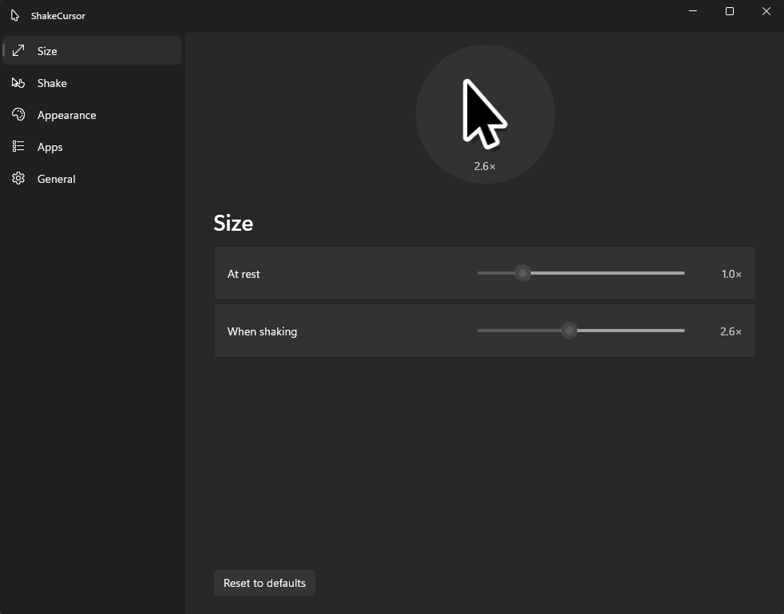

# ShakeCursor

Brings the macOS "shake to enlarge" pointer feature to Windows.

Windows renders cursors as fixed-size 32x32 bitmaps, which makes smooth
enlargement impossible natively. ShakeCursor blanks the real system arrow and
draws its own replacement as a topmost, click-through layered window — so the
cursor is a vector shape that scales smoothly and stays crisp at any size.



## How it works

1. **`CursorSwapper`** creates a fully-transparent cursor (`CreateCursor` with
   all-zero AND/XOR planes) and installs it into the `OCR_NORMAL` slot with
   `SetSystemCursor`. System defaults are restored via
   `SystemParametersInfo(SPI_SETCURSORS)` on every exit path (tray exit,
   process exit, unhandled exception) and once at startup, in case a previous
   run was killed.
2. **`Watchdog`** is the same executable started as `ShakeCursor --watchdog <pid>`.
   It waits for the main process; if that dies without signalling a clean exit
   (Task Manager, crash), it restores the cursors. It does nothing if a new
   instance is already running.
3. **`OverlayForm`** is a `WS_EX_LAYERED | WS_EX_TRANSPARENT | WS_EX_NOACTIVATE`
   topmost window. Every frame is rendered with GDI+ into a premultiplied-alpha
   bitmap and pushed with `UpdateLayeredWindow` — no flicker, no activation,
   clicks pass through.
4. **`PointerWatcher`** polls `GetCursorInfo` at ~200 Hz on a dedicated
   above-normal-priority thread. Crucially, it checks the *active* cursor
   handle: the overlay only shows when the app actually asked for the arrow.
   I-beam, resize, and hand cursors render natively and the overlay hides.
5. **`ShakeDetector`** accumulates intensity on high-speed direction reversals,
   decays it exponentially, and maps it to a target scale. The scale is
   exponentially smoothed (fast grow, slower shrink) for the fluid macOS feel.
6. **`Settings/` (WinUI 3 app)** is a separate executable, `ShakeCursor.Settings.exe`,
   built with the Windows App SDK: Mica backdrop, a `NavigationView` sidebar,
   Windows Settings-style cards and the native `ColorPicker`. It edits
   `settings.json`; the tray app watches that file and applies changes live, so
   the two never talk directly. Its preview runs its own `ShakeDetector`.

## Download

Grab `ShakeCursor-win-Setup.exe` from
[Releases](https://github.com/LyAhn/ShakeCursor/releases) and run it. It installs
per user (no admin prompt), is self-contained (no runtime install) and needs
Windows 10 1809 or later on x64. The build is unsigned, so SmartScreen may warn
on first run.

An installed copy checks for updates in the background, downloads them, and
offers a **Restart to update** item in the tray menu (plus a balloon tip). You
can also use **Check for updates** there. A portable
`ShakeCursor-win-Portable.zip` is attached to each release too; it does not
update itself. `.sha256` files are published for both downloads.

Releases are cut by pushing a version tag (`git tag -m v1.0.2 v1.0.2 && git push origin v1.0.2`);
the **Release** workflow builds the installer and update packages with
[Velopack](https://velopack.io) and publishes them.

## Building from source

```
dotnet run --project ShakeCursor
```

Building needs the .NET 10 SDK and the Windows App Runtime 1.8. A tray icon appears ("ShakeCursor"). Shake your mouse
vigorously — the cursor grows, then settles back. Open **Settings...** from the
tray menu; exit (and restore your cursor) from the same menu.
`ShakeCursor --settings` opens the settings window on launch. A normal build
of `ShakeCursor.csproj` also builds the settings app into `Settings\` next to
the main exe.

## Settings

A sidebar switches between pages; the preview card at the top is always
visible and animates when you shake, using the values you are editing.
Changes apply live and are saved to `%APPDATA%\ShakeCursor\settings.json`
(the settings app writes it, the tray app reloads it).

| Page | Setting | Range |
|---|---|---|
| Size | At rest | 0.5–2.0× |
| Size | When shaking | 1.5–4.0× |
| Shake | Sensitivity | 0.5–2.0× |
| Shake | Hold time | 0.25–3.0 s |
| Appearance | Fill, Outline | any colour (native colour picker, `#RRGGBB`) |
| Appearance | Shadow | on / off |
| Apps | Excluded apps | process names (pick a running app or browse for an `.exe`) |
| General | Start with Windows | on / off (the tray app applies it to the per-user Run registry key) |

**Excluded apps:** while an excluded app is in the foreground, ShakeCursor
hands the real system arrow back and hides its overlay; it takes over again
when you switch away. Matching is by process name, case-insensitive.

## Tuning

Feel constants that are not exposed in the UI live at the top of
`ShakeDetector.cs`:

| Constant | Effect |
|---|---|
| `MinShakeSpeed` | How fast a swing must be for a reversal to count as a shake |
| `IntensityHoldTau` / `IntensityIdleTau` | How quickly intensity decays while moving / at rest |
| `IntensityStart` / `IntensityFull` | Shake intensity → size ramp |
| `GrowTau` / `ShrinkTau` | Animation speed of growing / shrinking |

## Known limitations (v1)

- **Only the arrow is replaced.** Text beams, resize and hand cursors show
  natively (and correctly) but don't enlarge.
- **Cached class cursors:** a few apps register an arrow handle in their window
  class before the swap; those windows keep showing the real arrow.
- **"End process tree"** in Task Manager also kills the watchdog. Ending only
  the main process is covered. If the cursor is stuck blank, change your
  pointer scheme in Settings, or re-run and exit cleanly.
- **Exclusive fullscreen games** render their own cursor; expect duplication
  there. A per-app exclusion list is on the roadmap.
- **Mixed-DPI monitors** use the system DPI for sizing; per-monitor scaling is
  a later refinement.

## Roadmap

- Full cursor set with faithful shapes (I-beam, resize, hand) — requires
  intercepting `SetCursor` globally via an injected hook DLL.
- DirectComposition rendering for even lower-latency animation.

## Licence

[MIT](LICENSE)
